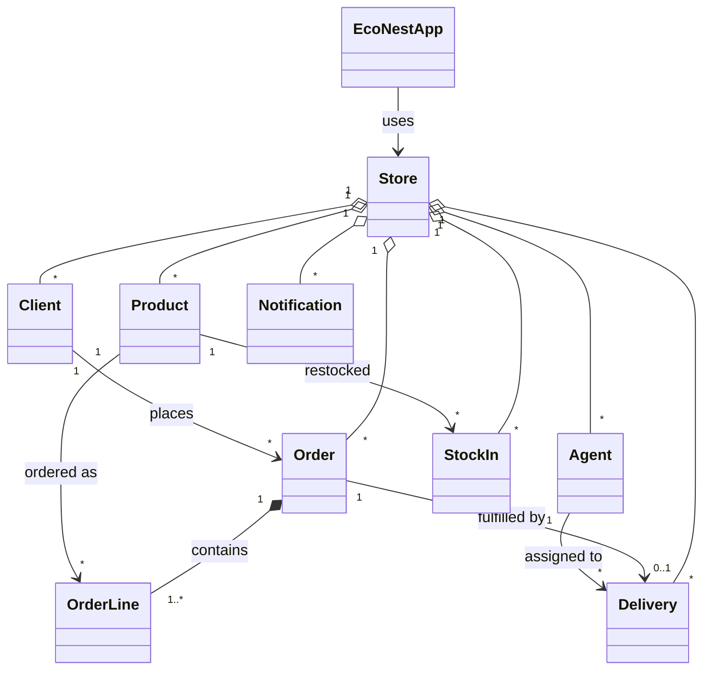
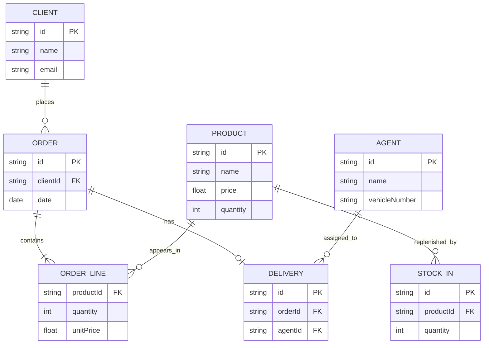

# EcoNest project checklist and demonstration plan

Based on the supplied `OOP_Project_2027 (1).docx` specification. The document lists 9 functional requirements for the Java Swing desktop app, group size 5–8, and individual use case, class and ER diagrams.

## Suggested demo flow

1. Open **Dashboard**: verify four KPIs, recent orders, stock alerts and summary values.
2. **Products**: add one new Indoor Plant with price and eco rating, edit it, and remove an unused product.
3. **Clients**: add one Household client and one Office client, update email and address, then remove an unused client.
4. **Inventory**: create supplier stock-in and verify quantity increases and stock history logs the supplier and date. Test low-stock status.
5. **Delivery Agents**: add an agent with a vehicle type and registration; edit their details.
6. **Orders**: create an order containing 2 different products; verify quantity cannot exceed stock, totals are correct, and stock decreases. Open View Details.
7. **Deliveries**: assign an agent and schedule a date; verify an agent email is queued. Change delivery status to Dispatched; verify a client email is queued. Change to Delivered and confirm order completion.
8. **Reports**: choose this month; verify revenue and order totals, low-stock inventory table, and export a CSV file.
9. **Notifications**: preview queued emails. Configure real SMTP SSL credentials and test send with valid recipients (requires internet).
10. Close and reopen the app; verify all entered data was retained.

## Optional testing / edge cases

- Empty required names, malformed email addresses, negative or nonnumeric prices, negative stock, overlarge order quantity, zero stock-in amount.
- Attempt to delete a product/client/agent referenced by another record.
- Cancel an unshipped order: verify stock restored. Try to cancel a delivered order: should be blocked.
- Assign a delivery with a past date: should be rejected.
- Repeat dispatch status: should not enqueue a second client notification for the same delivery.
- SMTP failure: notification should remain pending until sent.

## Data model overview

- `Product`: id, name, category, price, ecoRating, quantity, reorderLevel
- `Client`: id, name, type, email, phone, address
- `Agent`: id, name, email, phone, vehicleType, vehicleNumber
- `Order`: id, clientId, date, status, order items
- `OrderLine`: productId, quantity, unitPrice
- `Delivery`: id, orderId, agentId, scheduled, status, clientNotified
- `StockIn`: id, productId, quantity, supplier, reference, date
- `Notification`: id, to, subject, body, kind, timestamp, sent

## Mermaid draft class diagram

## Mermaid draft ER diagram

*Conceptual entity relationship view; actual application data is stored as serialized Java objects, not SQL tables.*

